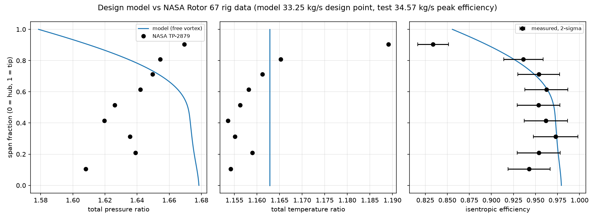
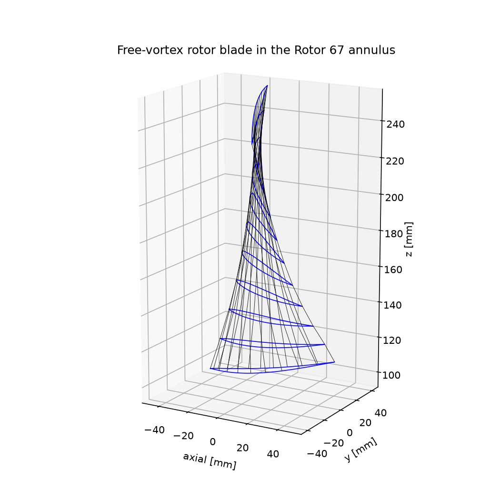
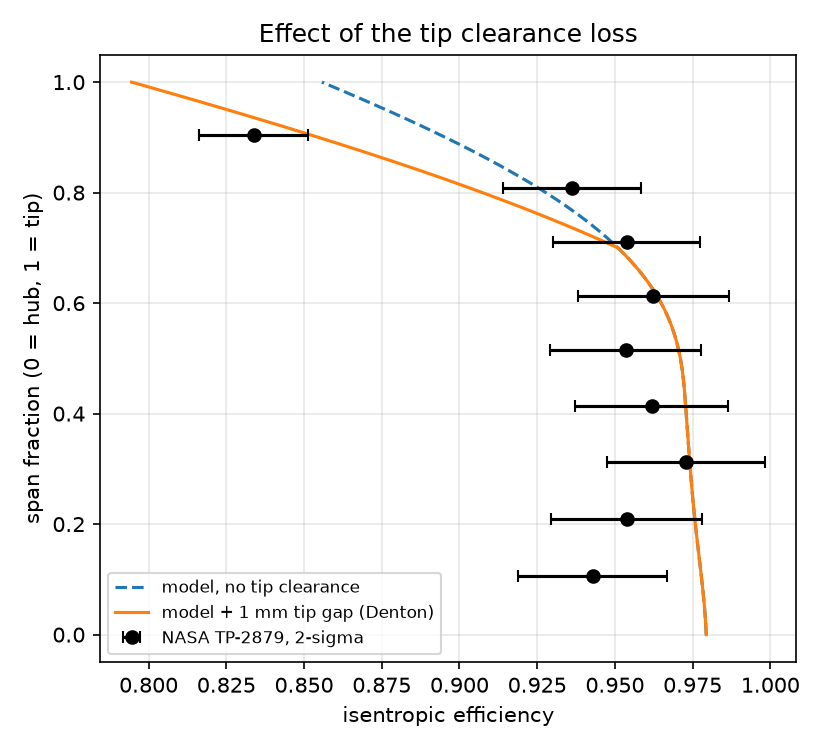

# Transonic Fan Design and Validation: From Velocity Triangles to Rig Data

[](https://github.com/SirPicklee/transonic-fan/actions/workflows/tests.yml)

A Python toolkit for the aerodynamic design of a transonic axial fan rotor, built step by step from velocity triangles to a 3D blade, and validated against the NASA Rotor 67 rig data (Strazisar et al., NASA TP-2879, 1989). It covers meanline and spanwise design, loss and efficiency prediction, blade geometry, processing of raw rig survey data with a measurement uncertainty analysis, a tip clearance loss model, and a vibration and flutter screening. 103 automated tests check the physics against exact solutions and published data.



## At a glance

| Area | Result |
|---|---|
| Annulus sizing | Rotor 67 tip relative Mach number 1.406 from mass flow, speed and diameters alone (NASA: 1.38) |
| Spanwise design | Simple radial equilibrium with loss and entropy coupling; free, constant-swirl and forced vortex compared |
| Loss model | Lieblein profile loss and shock loss predict the hub stall of two of the three vortex designs |
| Geometry | Aspect ratio from the published solidities 1.53 (NASA: 1.56), after a check exposed a wrong chord assumption |
| Rig data | NASA performance reproduced from the raw probe surveys: efficiency 0.930 (NASA 0.930), exit mass flow within 0.03 % |
| Uncertainty | Monte Carlo: efficiency 0.930 ± 0.017 (2σ); thermocouple bias triples the uncertainty of random errors alone |
| Validation | With a 1 mm tip clearance loss the model gives 0.938, inside the measurement uncertainty, with no tuning |
| Vibration | Campbell diagram finds a first torsion / 4th engine order crossing at 98.9 % speed; flutter screening passes |

## Contents

1. [Velocity triangles](#1-velocity-triangles)
2. [Annulus sizing](#2-annulus-sizing)
3. [Radial equilibrium and choice of vortex](#3-radial-equilibrium-and-choice-of-vortex)
4. [Losses and predicted efficiency](#4-losses-and-predicted-efficiency)
5. [Blade geometry](#5-blade-geometry)
6. [Rig data processing](#6-rig-data-processing)
7. [Measurement uncertainty and validation](#7-measurement-uncertainty-and-validation)
8. [Tip clearance loss](#8-tip-clearance-loss)
9. [Vibration and flutter screening](#9-vibration-and-flutter-screening)
10. [Engineering lessons](#10-engineering-lessons)
11. [Limitations](#11-limitations)
12. [Structure and usage](#12-structure-and-usage)

---

## 1. Velocity triangles

Euler work, flow and loading coefficients, de Haller ratio, Lieblein diffusion factor and relative Mach number at one radius. A test checks that the Euler work U ΔCθ equals its three-term kinetic energy form, which ties the kinematics to the energy equation.

## 2. Annulus sizing

Compressible continuity through the inlet annulus. From the published Rotor 67 mass flow (33.25 kg/s), speed (16 043 rpm) and inlet diameters, the tip relative Mach number comes out at **1.406**, against **1.38** in the report (1.9 %). The difference is consistent with the two simplifications: the blade speed is taken at the casing radius, and the axial velocity is uniform, while the casing boundary layer lowers it near the tip.

## 3. Radial equilibrium and choice of vortex

The exit swirl distribution C_θ = C_θm (r/r_m)^n is chosen, the work follows from the Euler equation, and simple radial equilibrium (with the entropy gradient) sets the axial velocity along the span. Streamlines are matched between inlet and exit by mass fraction, so the contracting Rotor 67 annulus is represented.


At the same mass-averaged pressure ratio:

| Vortex | Exit axial velocity, hub → tip | Diffusion factor at hub |
|---|---|---|
| Free (n = −1) | 167 → 167 m/s | 0.48 |
| Constant swirl (n = 0) | 122 → 204 m/s | 0.57 |
| Forced (n = +1) | 58 → 242 m/s | 0.53 |

Reducing the hub work does not unload the hub: radial equilibrium pushes the flow outwards and the hub axial velocity drops, which is itself diffusion.

## 4. Losses and predicted efficiency

Profile loss from Lieblein's correlation in the equivalent diffusion ratio D_eq, shock loss from a normal shock at the inlet relative Mach number. The rotor is followed along each streamline with rothalpy conserved, and the efficiency is fed back into the radial equilibrium through the entropy gradient until both converge.


| Vortex | Result |
|---|---|
| Free | Efficiency 0.949, pressure ratio 1.653, max D_eq 1.97 |
| Constant swirl | Hub runaway, D_eq reaches 3.68: predicted hub stall |
| Forced | Hub runaway, D_eq reaches 2.41: predicted hub stall |

The runaway is a real feedback loop: loss raises entropy, radial equilibrium lowers the hub axial velocity, diffusion and loss rise further. Lieblein's data end near D_eq = 2. Shock loss is zero over the inner half of the span and reaches 0.063 at the tip, where the efficiency falls to 0.86.

## 5. Blade geometry

Blade metal angles from Carter's deviation rule, circular-arc camber lines with a lens-shaped (DCA-like) thickness, chord from solidity, sections stacked on their area centroids and wrapped onto the streamline surfaces. Exports: STL surface and CSV section points ([3D model](figures/rotor67_free_vortex_blade.stl), viewable on GitHub).


| Span | Chord | Camber | Stagger |
|---|---|---|---|
| Hub | 94.4 mm | 69.2° | −8.3° |
| Mid | 94.3 mm | 25.7° | −47.4° |
| Tip | 92.0 mm | 4.8° | −65.6° |

**Geometry check.** With the solidity varied linearly from the published 3.11 (hub) to 1.29 (tip), the span-to-chord ratio came out at 1.35 against NASA's aspect ratio of 1.56. The published end values imply nearly the same chord at hub and tip (94 and 92 mm), so the solidity must fall as 1/r. With a nearly constant chord the ratio is 1.53.



## 6. Rig data processing

The radial surveys of tables III and IV of NASA TP-2879 (total and static pressure, total temperature and flow angle at rotor inlet and exit) were transcribed from the page images, since the OCR text layer of the scanned report contains errors. From these raw readings: Mach number, velocity and density at each probe, mass flow through each annular element, per-streamline pressure ratio, temperature ratio and efficiency, and mass- and energy-averaged rotor performance.

| Peak efficiency point | This code | NASA |
|---|---|---|
| Mass flow, station 1 | 34.97 kg/s | 35.00 kg/s |
| Mass flow, station 2 | 35.52 kg/s | 35.53 kg/s |
| Total pressure ratio | 1.641 | 1.642 |
| Total temperature ratio | 1.164 | 1.164 |
| Adiabatic efficiency | **0.930** | **0.930** |

At the near-stall point the efficiency is 0.906 against the published 0.901. The whole difference comes from the temperature ratio, 1.187 against 1.188: with a temperature rise of only about 54 K, 0.3 K of temperature error moves the efficiency by 0.5 points.

## 7. Measurement uncertainty and validation

Every probe reading is perturbed by a random error and every station's instruments by a common bias (assumed: 0.25 K and 0.1 % of pressure per reading, 0.25 K and 0.05 % per station, 0.5° of flow angle; typical research rig values, not from the report), and the whole processing chain is rerun 2000 times.

| Errors included | Measured efficiency (2σ) |
|---|---|
| Random only | 0.930 ± 0.006 |
| Random and bias | **0.930 ± 0.017** |

More probes reduce only the random part; the bias is reduced only by calibration. A hand estimate gives the same 0.017.

Model against measurement, efficiency along the span:

| Region | Model − measured | 2σ | Verdict |
|---|---|---|---|
| Tip (90 % span) | +0.060 | 0.018 | real difference |
| Mid span (30–80 %) | −0.011 to +0.017 | ~0.024 | agreement |
| Hub (11 % span) | +0.035 | 0.024 | real difference |

The core-flow physics is confirmed within the measurement uncertainty over most of the span. The differences sit at the endwalls, where the model has no tip clearance or secondary-flow loss. The design model is evaluated at the 33.25 kg/s design point and the test at the 34.57 kg/s peak-efficiency point.

## 8. Tip clearance loss

Denton's (1993) leakage mixing model: the pressure difference across the tip drives a jet through the gap, and its mixing with the main flow generates entropy. Gap (1 mm) and discharge coefficient (0.8) are taken from the literature; nothing is fitted to the rig data.



| | Efficiency |
|---|---|
| Model without tip clearance | 0.949 |
| Model with 1 mm tip clearance | **0.938** |
| Measured | 0.930 ± 0.017 |

1 mm costs 1.1 efficiency points, 1.6 points per 1 % of clearance-to-span ratio, within the usual 1–2 point rule of thumb. At 90 % span the difference falls from +0.060 to +0.018; at 81 % span the model now under-predicts by 0.033, because the loss is spread over the outer 30 % of the span (an assumption) while the measurement shows a narrower affected region. The width was deliberately not tuned to the same data used to judge it.

## 9. Vibration and flutter screening

The blade is a cantilever beam clamped at the hub with the section properties of the designed sections: Euler-Bernoulli bending elements with centrifugal stiffening, St Venant torsion, Ti-6Al-4V assumed. The finite element model is checked against the exact uniform cantilever frequencies and the Southwell coefficient of a rotating beam (1.1734).


| Mode | 0 rpm | Design speed |
|---|---|---|
| 1st flap | 526 Hz | 688 Hz |
| 2nd flap | 1991 Hz | 2178 Hz |
| 1st torsion | 1057 Hz | 1057 Hz |

- **1st torsion crosses the 4th engine order at 98.9 % speed**, inside the operating range: a resonance if four struts or a four-lobe inlet distortion are present. Raising the tip thickness would move it up, at the cost of more shock loss.
- 1st flap stays 29 % above the 2nd engine order at design speed.
- Lowest reduced frequency (semichord, inlet relative velocity): 0.43 for the 1st flap mode at the tip, above the assumed screening value of 0.3.

## 10. Engineering lessons

| Hypothesis | Test | Outcome |
|---|---|---|
| Less swirl at the hub unloads the hub | Radial equilibrium at equal pressure ratio | Wrong: the hub axial velocity drops and the diffusion factor rises from 0.48 to 0.57 |
| A linear solidity variation is good enough | Aspect ratio against NASA | Wrong: 1.35 vs 1.56; the blade has a nearly constant chord |
| The 0.019 efficiency gap proves missing physics | Monte Carlo uncertainty | Not on its own: 2σ is 0.017. The spanwise comparison locates the gap at the endwalls |
| More probes give a more accurate efficiency | Random vs bias errors | Only for random errors: the bias triples the uncertainty and does not average out |
| The near-stall efficiency mismatch is a processing error | Sensitivity to the temperature ratio | No: 0.001 in temperature ratio is 0.5 efficiency points |
| A tip loss spread over 30 % of the span is reasonable | Comparison at 81 % span | Too wide; not tuned, to avoid validating on the data it was fitted to |

## 11. Limitations

- Simple radial equilibrium: cylindrical streamlines, no streamline curvature, uniform inflow.
- Shock loss from a normal shock at the inlet relative Mach number; no shock–leakage interaction.
- No hub endwall or secondary-flow loss; the tip clearance loss is not coupled into the radial equilibrium.
- The designed blade is a free-vortex blade in the Rotor 67 annulus, not the Rotor 67 blade; thickness distribution (10 % hub, 3 % tip) assumed.
- Design-point analysis only, no off-design speedlines.
- Vibration: uncoupled modes, no centrifugal stiffening in torsion, rigid root and disc, material assumed.
- Instrument accuracies in the uncertainty analysis are typical values, not those of the original rig.

## 12. Structure and usage

```
fan/
  velocity_triangles.py   Euler work, loading, de Haller, diffusion factor, Mach numbers
  annulus.py              compressible annulus sizing, Rotor 67 data
  radial_equilibrium.py   simple radial equilibrium, vortex design
  losses.py               Lieblein profile loss, shock loss, efficiency, hub stall detection
  blade_angles.py         incidence and Carter's deviation rule
  blade_sections.py       circular-arc camber line and thickness
  blade3d.py              stacking, STL and CSV export
  rig_data.py             NASA TP-2879 tables (data/)
  rig_analysis.py         processing of the probe surveys
  validation.py           Monte Carlo measurement uncertainty, model vs rig
  tip_clearance.py        Denton leakage mixing loss
  vibration.py            beam finite elements, Campbell diagram, flutter screening
data/                     transcribed NASA TP-2879 tables
tests/                    103 tests: exact solutions, conservation laws, published data
```

```bash
python -m venv .venv
source .venv/bin/activate
pip install -r requirements.txt

python -m pytest                  # about 5 seconds
python -m fan.rig_analysis        # reproduce the NASA performance
python -m fan.validation          # uncertainty and model vs rig
python -m fan.vibration           # Campbell diagram
```

## References

1. A. J. Strazisar, J. R. Wood, M. D. Hathaway, K. L. Suder, *Laser Anemometer Measurements in a Transonic Axial-Flow Fan Rotor*, NASA TP-2879, 1989.
2. S. Lieblein, F. C. Schwenk, R. L. Broderick, *Diffusion Factor for Estimating Losses and Limiting Blade Loadings in Axial-Flow-Compressor Blade Elements*, NACA RM E53D01, 1953.
3. S. Lieblein, *Loss and Stall Analysis of Compressor Cascades*, ASME Journal of Basic Engineering, 1959.
4. J. D. Denton, *Loss Mechanisms in Turbomachines*, ASME Journal of Turbomachinery 115, 1993.
5. S. L. Dixon, C. A. Hall, *Fluid Mechanics and Thermodynamics of Turbomachinery*, Butterworth-Heinemann.
6. N. A. Cumpsty, *Compressor Aerodynamics*, Krieger.