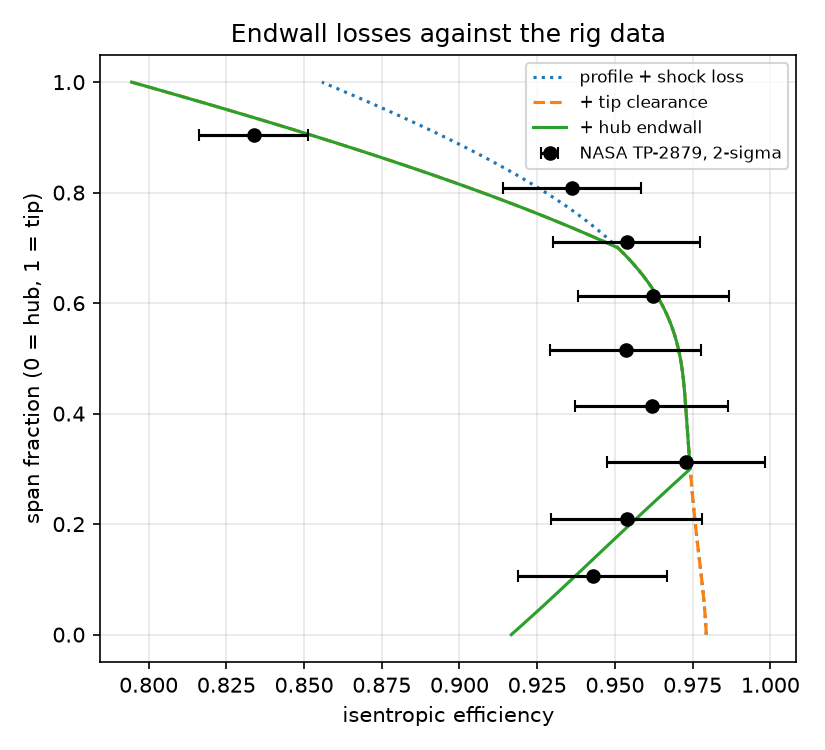
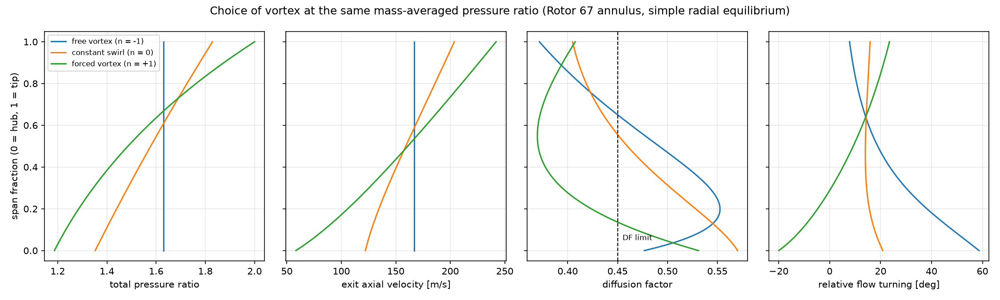
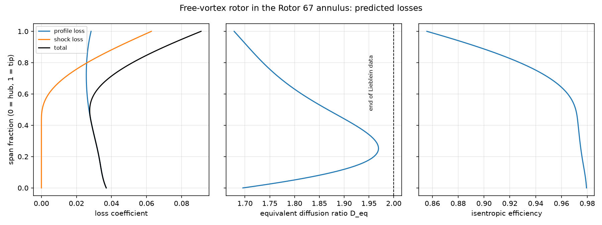
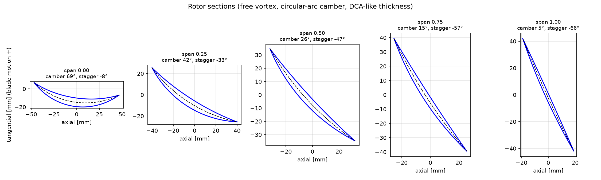
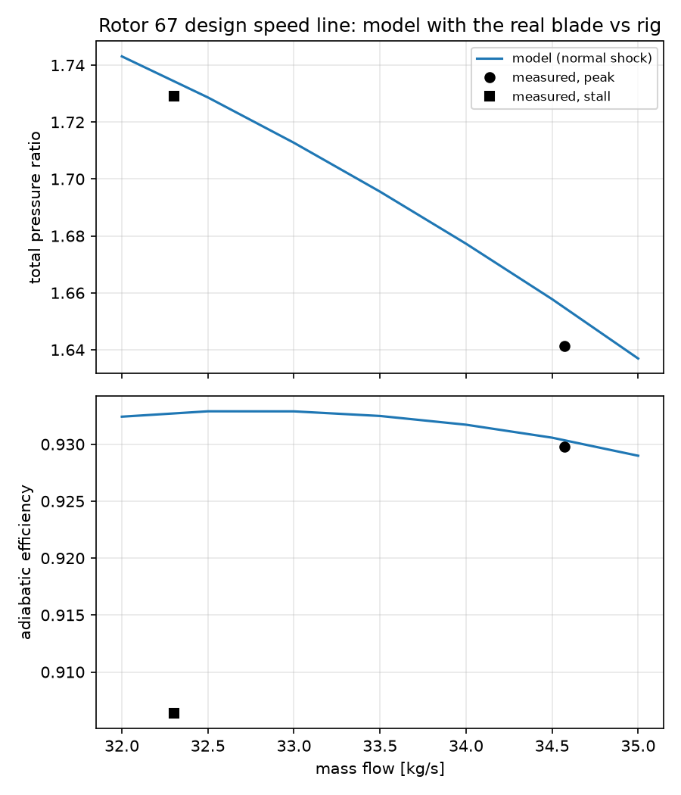
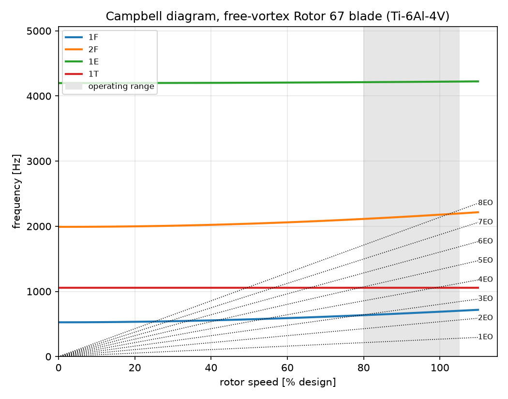
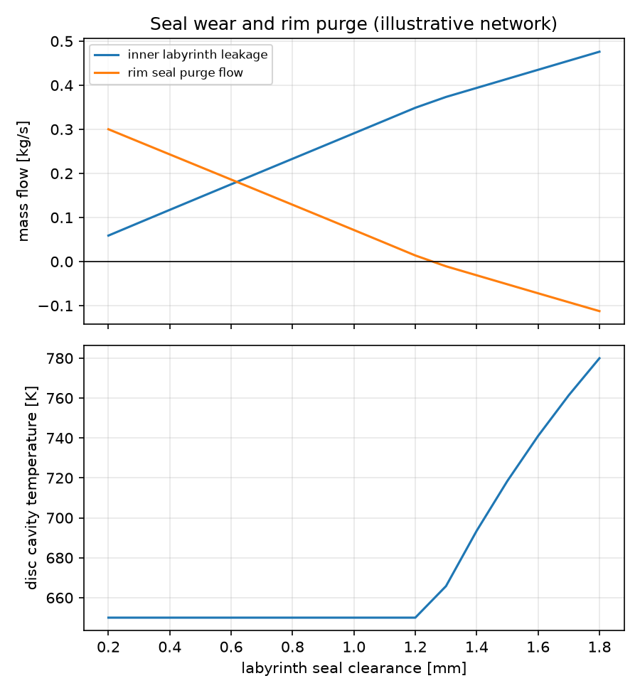

# Transonic Fan Design and Validation: From Velocity Triangles to Rig Data

[](https://github.com/SirPicklee/transonic-fan/actions/workflows/tests.yml)

A Python toolkit for the aerodynamic design and analysis of a transonic axial fan rotor, built step by step from velocity triangles to a 3D blade and validated against the NASA Rotor 67 rig data (Strazisar et al., NASA TP-2879, 1989). It covers spanwise design with radial equilibrium, loss and efficiency prediction (profile, shock, tip clearance and hub endwall losses), blade geometry, processing of raw rig survey data with a Monte Carlo uncertainty analysis, an off-design analysis of Rotor 67 with its real blade geometry, a vibration and flutter screening, and a secondary air flow network. 139 automated tests check the physics against exact solutions, conservation laws and published data.



## At a glance

| Area | Result |
|---|---|
| Rig data | NASA performance reproduced from the raw probe surveys: efficiency 0.930 (NASA 0.930), exit mass flow within 0.03 % |
| Uncertainty | Monte Carlo: efficiency 0.930 ± 0.017 (2σ); thermocouple bias triples the uncertainty of random errors alone |
| Loss model | Profile, shock, tip clearance and hub endwall losses: 0.931 predicted vs 0.930 measured, 8 of 9 spanwise probes inside the measurement uncertainty, no coefficient fitted to the rig data |
| Shock loss | Miller-Lewis-Hartmann model shows why transonic blades carry little front camber: moving camber aft gains 2.2 efficiency points |
| Real blade | Rotor 67 geometry transcribed from the report; chord recomputed from coordinates matches the published solidity within 0.5 % |
| Off-design | With the real blade, pressure ratio predicted within 0.3 % at the near-stall point; the efficiency drop towards stall is not captured, and why |
| Vibration | Campbell diagram finds a first torsion / 4th engine order crossing at 98.9 % speed; flutter screening passes |
| Secondary air | Flow network: labyrinth seal wear steals rim purge flow one for one; hot gas ingestion at about 1.25 mm clearance |

## Contents

1. [Velocity triangles and annulus sizing](#1-velocity-triangles-and-annulus-sizing)
2. [Radial equilibrium and choice of vortex](#2-radial-equilibrium-and-choice-of-vortex)
3. [Profile and shock losses](#3-profile-and-shock-losses)
4. [Blade geometry](#4-blade-geometry)
5. [Rig data processing](#5-rig-data-processing)
6. [Measurement uncertainty](#6-measurement-uncertainty)
7. [Endwall losses and validation](#7-endwall-losses-and-validation)
8. [Shock model and front camber](#8-shock-model-and-front-camber)
9. [Rotor 67 off-design with the real blade](#9-rotor-67-off-design-with-the-real-blade)
10. [Vibration and flutter screening](#10-vibration-and-flutter-screening)
11. [Secondary air system](#11-secondary-air-system)
12. [Engineering lessons](#12-engineering-lessons)
13. [Limitations](#13-limitations)
14. [Structure and usage](#14-structure-and-usage)

---

## 1. Velocity triangles and annulus sizing

Euler work, flow and loading coefficients, de Haller ratio, Lieblein diffusion factor and relative Mach number. A test checks that the Euler work U ΔCθ equals its three-term kinetic energy form.

From the published Rotor 67 mass flow (33.25 kg/s), speed (16 043 rpm) and inlet diameters alone, compressible continuity gives a tip relative Mach number of **1.406** against **1.38** in the report (1.9 %). The difference is consistent with taking the blade speed at the casing radius and assuming uniform axial velocity, while the casing boundary layer lowers it near the tip.

## 2. Radial equilibrium and choice of vortex

The exit swirl distribution C_θ = C_θm (r/r_m)^n is chosen, the work follows from the Euler equation, and simple radial equilibrium (with the entropy gradient) sets the axial velocity along the span. Streamlines are matched between inlet and exit by mass fraction, so the contracting Rotor 67 annulus is represented.



| Vortex, same mass-averaged pressure ratio | Exit axial velocity, hub → tip | Diffusion factor at hub |
|---|---|---|
| Free (n = −1) | 167 → 167 m/s | 0.48 |
| Constant swirl (n = 0) | 122 → 204 m/s | 0.57 |
| Forced (n = +1) | 58 → 242 m/s | 0.53 |

Reducing the hub work does not unload the hub: radial equilibrium pushes the flow outwards and the hub axial velocity drops, which is itself diffusion.

## 3. Profile and shock losses

Profile loss from Lieblein's correlation in the equivalent diffusion ratio D_eq, shock loss from a normal shock at the inlet relative Mach number. Each streamline is followed with rothalpy conserved, and the efficiency is fed back into the radial equilibrium through the entropy gradient until both converge.



| Vortex | Result |
|---|---|
| Free | Efficiency 0.949, pressure ratio 1.653, max D_eq 1.97 |
| Constant swirl | Hub runaway, D_eq reaches 3.68: predicted hub stall |
| Forced | Hub runaway, D_eq reaches 2.41: predicted hub stall |

The runaway is a real feedback loop: loss raises entropy, radial equilibrium lowers the hub axial velocity, diffusion and loss rise further. Lieblein's data end near D_eq = 2.

## 4. Blade geometry

Metal angles from Carter's deviation rule, circular-arc or two-arc camber lines with a lens-shaped thickness, chord from solidity, sections stacked on their area centroids and wrapped onto the streamline surfaces. Exports: STL surface ([3D model](figures/rotor67_free_vortex_blade.stl), viewable on GitHub) and CSV section points.



**Geometry check.** With the solidity varied linearly from the published 3.11 (hub) to 1.29 (tip), the span-to-chord ratio came out at 1.35 against NASA's aspect ratio of 1.56. The published end values imply nearly the same chord at hub and tip, so the solidity must fall as 1/r; with a nearly constant chord the ratio is 1.53. The real blade (section 9) confirms it: 92–95 mm chord from hub to tip.

## 5. Rig data processing

The radial surveys of tables III and IV of NASA TP-2879 were transcribed from the page images (the OCR text layer of the scanned report contains errors). From the raw readings: Mach number, velocity and density at each probe, mass flow through each annular element, per-streamline pressure ratio, temperature ratio and efficiency, and mass- and energy-averaged rotor performance.

| Peak efficiency point | This code | NASA |
|---|---|---|
| Mass flow, station 1 | 34.97 kg/s | 35.00 kg/s |
| Mass flow, station 2 | 35.52 kg/s | 35.53 kg/s |
| Total pressure ratio | 1.641 | 1.642 |
| Total temperature ratio | 1.164 | 1.164 |
| Adiabatic efficiency | **0.930** | **0.930** |

At the near-stall point the efficiency is 0.906 against the published 0.901. The whole difference comes from the temperature ratio, 1.187 against 1.188: with a temperature rise of about 54 K, 0.3 K of temperature error moves the efficiency by 0.5 points.

## 6. Measurement uncertainty

Every probe reading is perturbed by a random error and every station's instruments by a common bias (assumed: 0.25 K and 0.1 % of pressure per reading, 0.25 K and 0.05 % per station, 0.5° of flow angle; typical research rig values, not from the report), and the whole processing chain is rerun 2000 times.

| Errors included | Measured efficiency (2σ) |
|---|---|
| Random only | 0.930 ± 0.006 |
| Random and bias | **0.930 ± 0.017** |

More probes reduce only the random part; the bias is reduced only by calibration. A hand estimate gives the same 0.017.

## 7. Endwall losses and validation

Starting from profile and shock loss only, the model over-predicted the efficiency at both endwalls. Two physics-based endwall models were added, with nothing fitted to the rig data:

- **Tip clearance**, Denton's (1993) leakage mixing model: the pressure difference across the tip drives a jet through the 1 mm gap, and its mixing generates entropy. 1.1 efficiency points, 1.6 points per 1 % of clearance-to-span ratio, within the usual rule of thumb.
- **Hub endwall**, Howell's secondary loss (0.018 C_L², half attributed to the hub) and Denton's endwall dissipation (C_d = 0.002): 0.57 and 0.08 points.

| Model | Efficiency |
|---|---|
| Profile and shock loss | 0.949 |
| + tip clearance | 0.938 |
| + tip clearance + hub endwall | **0.931** |
| Measured | **0.930 ± 0.017** |

| Span | Model − measured | 2σ |
|---|---|---|
| 90 % | +0.018 | 0.018 |
| 81 % | −0.033 | 0.022 |
| 71 % to 31 % | −0.007 to +0.017 | ~0.024 |
| 21 % | +0.003 | 0.024 |
| 11 % | −0.006 | 0.024 |

Eight of nine probes fall inside the measurement uncertainty. At 81 % span the tip loss, spread over the outer 30 % of the span (an assumption), over-corrects: the measurement shows a narrower affected region. The width was deliberately not tuned to the data used to judge it. Howell's correlation is not applied at the casing, where the stagger of about 66° makes its 1/cos³ factor meaningless.

## 8. Shock model and front camber

The Miller-Lewis-Hartmann model places a normal shock at the passage entrance, from the leading edge of one blade to the suction surface of the next, at the average of the inlet Mach number and the suction-surface Mach number reached by Prandtl-Meyer expansion. The expansion angle is measured from the inlet flow direction to the suction surface at the shock: a thickness wedge inclined into the flow compresses it at the leading edge rather than expanding it.

| Shock model and camber line | Efficiency* | Expansion before the shock, 60 % span |
|---|---|---|
| Normal shock at M1 | 0.949 | — |
| MLH, circular arc (50 % of camber in front half) | 0.906 | 11.6° |
| MLH, 25 % front camber | 0.922 | 6.9° |
| MLH, 15 % front camber | 0.928 | 4.6° |

*profile and shock loss only. Moving the camber aft gains 2.2 points, which is why transonic blades carry little camber ahead of the passage shock. The real Rotor 67 blade does exactly this (section 9).

The 0.928 is close to the measured 0.930, but the spanwise distribution is wrong (0.869 against 0.936 at 81 % span): two errors cancel. NASA's laser anemometer data (figure 17 of the report) show why MLH does not fit here: at peak efficiency the passage shock is oblique and weak, while near stall it detaches and stands normal ahead of the blade, the picture MLH assumes. The normal shock at M1 stays the default.

## 9. Rotor 67 off-design with the real blade

The geometry of the 14 blade sections of table I of the report was transcribed. The chord recomputed from the edge coordinates gives a solidity of 3.102 at the hub and 1.284 at the tip, against the published 3.11 and 1.29: an independent check of the transcription. The real blade confirms two design findings of this project: the front camber fraction falls from 0.44 at the hub to 0.10 at the tip, and the camber rises again over the outer 25 % of the span (9.1° to 11.4°), loading the tip more, which the rig data show as a temperature ratio rising towards the casing.

With the blade fixed and the mass flow imposed, the exit flow angle follows from the metal angle and Carter's deviation, so the swirl, and with it the work, follows the axial velocity. Lieblein's incidence term adds loss as the incidence rises above its value at the peak-efficiency point (the reference: an assumption).



| | Peak efficiency (34.57 kg/s) | | Near stall (32.31 kg/s) | |
|---|---|---|---|---|
| | Measured | Model | Measured | Model |
| Total pressure ratio | 1.641 | 1.655 | 1.729 | **1.734** |
| Total temperature ratio | 1.164 | 1.166 | 1.187 | 1.183 |
| Efficiency | 0.930 | 0.930* | 0.906 | 0.933 |

*by construction, the reference incidence is taken at this point.

- **The work is predicted from the geometry**: the rise of pressure ratio from 1.64 to 1.73 as the flow falls is reproduced within 0.3 %.
- **Incidence**: the real blade runs at about +6° to +8° over the inner span and +1° at the tip at peak efficiency.
- **Stall**: the model has no solution below about 31.5–32 kg/s, just under the last stable measured point.
- **The efficiency drop is not captured** (measured −2.4 points, concentrated at 70–80 % span). Both shock models depend only on the inlet Mach number, which hardly changes with mass flow; the measured drop comes from the shock moving forward and strengthening, and its interaction with the tip leakage flow. A one-dimensional shock model cannot predict where the shock stands; that needs a 3D flow solution.

## 10. Vibration and flutter screening

The blade is a cantilever beam clamped at the hub with the section properties of the designed sections: Euler-Bernoulli bending elements with centrifugal stiffening, St Venant torsion, Ti-6Al-4V assumed. The finite element model is checked against the exact uniform cantilever frequencies and the Southwell coefficient of a rotating beam (1.1734).



| Mode | 0 rpm | Design speed |
|---|---|---|
| 1st flap | 526 Hz | 688 Hz |
| 2nd flap | 1991 Hz | 2178 Hz |
| 1st torsion | 1057 Hz | 1057 Hz |

- **1st torsion crosses the 4th engine order at 98.9 % speed**, inside the operating range: a resonance if four struts or a four-lobe inlet distortion are present. Raising the tip thickness would move it up, at the cost of more shock loss.
- 1st flap stays 29 % above the 2nd engine order at design speed.
- Lowest reduced frequency (semichord, inlet relative velocity): 0.43 for the 1st flap mode at the tip, above the assumed screening value of 0.3.

## 11. Secondary air system

A flow network solver for the air bled from the compressor to cool discs, pressurise bearing chambers and purge rim cavities: chambers joined by compressible orifices (choking at the critical pressure ratio, checked against the same flow function as the annulus sizing) and labyrinth seals (Martin's equation), with mass conservation solved for the chamber pressures and mixing temperatures. The example network is illustrative, not a real engine.



| Labyrinth clearance | Labyrinth leakage | Rim purge flow | Disc cavity |
|---|---|---|---|
| 0.4 mm (new) | 0.117 kg/s | 0.243 kg/s | 650 K, margin 0.91 % |
| 1.0 mm | 0.291 kg/s | 0.072 kg/s | 650 K |
| about 1.25 mm | | 0 | hot gas ingestion begins |
| 1.8 mm | 0.476 kg/s | −0.113 kg/s | 780 K |

The large rim seal locks the disc cavity pressure to the hot gas pressure, so the total bleed stays at 0.36 kg/s: seal wear does not draw more air, it takes it from the purge flow, kilogram for kilogram.

## 12. Engineering lessons

| Hypothesis | Test | Outcome |
|---|---|---|
| Less swirl at the hub unloads the hub | Radial equilibrium at equal pressure ratio | Wrong: the hub axial velocity drops and the diffusion factor rises from 0.48 to 0.57 |
| A linear solidity variation is good enough | Aspect ratio against NASA | Wrong: 1.35 vs 1.56; the blade has a nearly constant chord |
| The 0.019 efficiency gap proves missing physics | Monte Carlo uncertainty | Not on its own: 2σ is 0.017; the spanwise comparison locates the gap at the endwalls |
| More probes give a more accurate efficiency | Random vs bias errors | Only for random errors: the bias triples the uncertainty |
| The near-stall efficiency mismatch is a processing error | Sensitivity to the temperature ratio | No: 0.001 in temperature ratio is 0.5 efficiency points |
| A tip loss spread over 30 % of the span is reasonable | Comparison at 81 % span | Too wide; not tuned, to avoid validating on the data it was fitted to |
| The supersonic expansion starts at the leading edge surface | MLH turning larger than the camber | Wrong: it starts at the flow direction; the thickness wedge compresses |
| A tip shock model does not affect the subsonic hub | Hub efficiency with MLH | Wrong: more tip loss shifts flow to the hub and lowers its diffusion |
| Overall agreement validates a loss model | MLH with 15 % front camber: 0.928 vs 0.930 | No: the spanwise errors cancel |
| Camber falls monotonically to the tip | Rotor 67 table I | Wrong: the tip is loaded more, as the rig temperature ratio shows |
| A 1-D shock loss can follow a speed line | Off-design with the real blade | No: pressure ratio within 0.3 %, but the efficiency drop needs the shock position |
| A worn seal draws more bleed air | Flow network | No: it takes the air from the rim purge |

## 13. Limitations

- Simple radial equilibrium: cylindrical streamlines, no streamline curvature, uniform inflow.
- Shock loss from a normal shock at the inlet relative Mach number (or MLH); neither follows the shock position.
- Endwall losses are applied after the radial equilibrium solution, spread over 30 % of the span with assumed linear ramps.
- Off-design: deviation held at its design value, reference incidence from the peak-efficiency point, choke side not modelled.
- The designed free-vortex blade is not the Rotor 67 blade; its thickness distribution (10 % hub, 3 % tip) is assumed. Sections 9 uses the real blade.
- Vibration: uncoupled modes, no centrifugal stiffening in torsion, rigid root and disc, material assumed.
- Secondary air: mean pressures only (real ingestion is driven by circumferential pressure variations from the vanes, so the margin is optimistic), no heat transfer or windage, no choking of the last labyrinth tooth.
- Instrument accuracies in the uncertainty analysis are typical values, not those of the original rig.

## 14. Structure and usage

```
fan/
  velocity_triangles.py   Euler work, loading, de Haller, diffusion factor, Mach numbers
  annulus.py              compressible annulus sizing, Rotor 67 data
  radial_equilibrium.py   simple radial equilibrium, vortex design, arbitrary swirl
  losses.py               Lieblein profile loss, efficiency, hub stall detection
  shock.py                normal shock and Miller-Lewis-Hartmann shock loss
  tip_clearance.py        Denton leakage mixing loss
  endwall.py              Howell secondary loss, Denton endwall dissipation
  blade_angles.py         incidence and Carter's deviation rule
  blade_sections.py       circular-arc and two-arc camber lines, thickness
  blade3d.py              stacking, STL and CSV export
  rotor67_geometry.py     Rotor 67 blade from table I of TP-2879
  off_design.py           Rotor 67 speed line with the real blade
  rig_data.py             NASA TP-2879 survey tables
  rig_analysis.py         processing of the probe surveys
  validation.py           Monte Carlo measurement uncertainty, model vs rig
  vibration.py            beam finite elements, Campbell diagram, flutter screening
  secondary_air.py        secondary air flow network
data/                     transcribed NASA TP-2879 tables
tests/                    139 tests: exact solutions, conservation laws, published data
```

```bash
python -m venv .venv
source .venv/bin/activate
pip install -r requirements.txt

python -m pytest                  # about 15 seconds
python -m fan.rig_analysis        # reproduce the NASA performance
python -m fan.endwall             # full loss model vs rig data
python -m fan.off_design          # Rotor 67 speed line with the real blade
python -m fan.secondary_air       # seal wear and rim purge
```

## References

1. A. J. Strazisar, J. R. Wood, M. D. Hathaway, K. L. Suder, *Laser Anemometer Measurements in a Transonic Axial-Flow Fan Rotor*, NASA TP-2879, 1989.
2. S. Lieblein, F. C. Schwenk, R. L. Broderick, *Diffusion Factor for Estimating Losses and Limiting Blade Loadings in Axial-Flow-Compressor Blade Elements*, NACA RM E53D01, 1953.
3. S. Lieblein, *Loss and Stall Analysis of Compressor Cascades*, ASME Journal of Basic Engineering, 1959.
4. G. C. Miller, G. W. Lewis, M. J. Hartmann, *Shock Losses in Transonic Compressor Blade Rows*, ASME Journal of Engineering for Power, 1961.
5. A. R. Howell, *Fluid Dynamics of Axial Compressors*, Proceedings of the Institution of Mechanical Engineers, 1945.
6. J. D. Denton, *Loss Mechanisms in Turbomachines*, ASME Journal of Turbomachinery 115, 1993.
7. S. L. Dixon, C. A. Hall, *Fluid Mechanics and Thermodynamics of Turbomachinery*, Butterworth-Heinemann.
8. N. A. Cumpsty, *Compressor Aerodynamics*, Krieger.